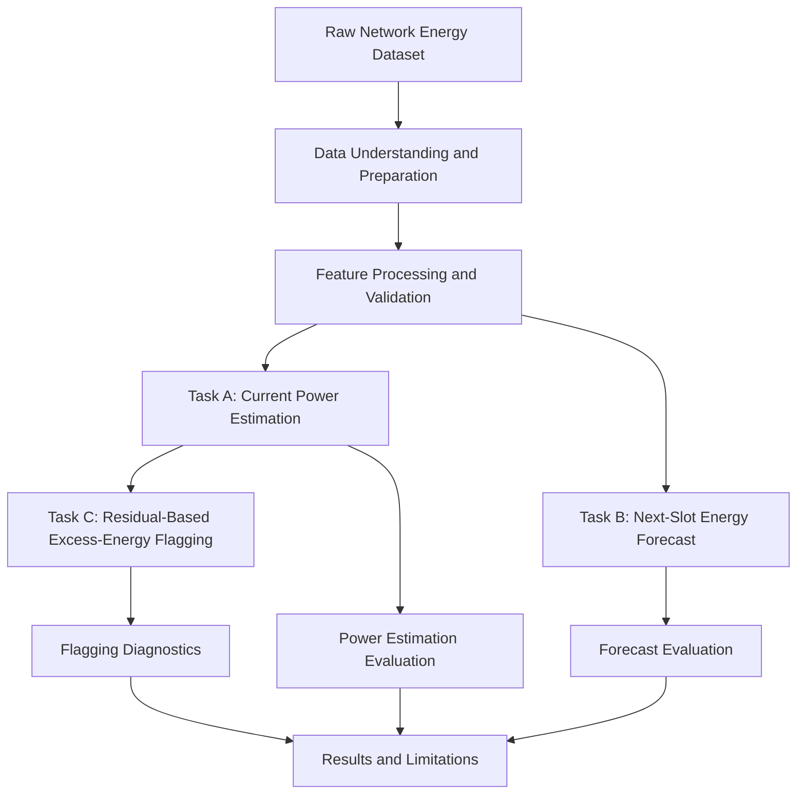

# ⚡ Predictive Modeling for Network Energy Consumption

### An ML-powered approach to power estimation, energy forecasting, and network inefficiency detection


## 🚀 Overview

Telecommunication networks continuously process changing traffic loads, user demands, and computing workloads. These variations influence hardware power consumption and make energy-efficient network operation a challenging problem.

**Predictive Modeling for Network Energy Consumption** is a multi-task machine-learning project designed to understand the relationship between network workload, active core nodes, resource utilization, and power consumption.

The project implements three complementary tasks:

- ⚡ **Estimate** the current power consumption of a network slot.
- 🔮 **Forecast** energy requirements for the next five-minute time slot.
- 🚨 **Detect** potentially inefficient network slots where power consumption is unusually high relative to expected workload.

Rather than treating energy consumption as a simple linear relationship, the project investigates nonlinear behavior, establishes baseline models, and evaluates predictive performance using chronological validation strategies.

The ultimate goal is to provide a data-driven foundation for energy-aware network planning and identifying configurations that may deserve further investigation.

> **Core idea:** Estimate what a network should consume, forecast what it will need next, and flag cases where actual power consumption appears unexpectedly high.

---

## 🎯 Project Objectives

1. Model the relationship between network traffic, resource utilization, active core nodes, and power consumption.
2. Build a reliable baseline before introducing more complex machine-learning models.
3. Forecast next-interval energy requirements without using information from the future.
4. Identify potentially inefficient energy-use patterns through validation-based residual analysis.
5. Maintain a reproducible pipeline with separate notebooks, datasets, and trained models.
6. Evaluate model performance using appropriate regression and diagnostic metrics.

---

## 🧠 The Three Tasks

<details>
<summary><strong>⚡ Task A — Current Power Estimation</strong></summary>

### Objective

Estimate the immediate power draw of a network slot using its concurrent workload and resource characteristics.

**Target:** Power consumption in watts (W).

**Approach:**
- Prepare and evaluate 27 concurrent load and resource features.
- Establish domain-informed linear and simple baseline models.
- Train an XGBoost regression model to capture nonlinear relationships and threshold behavior.
- Compare models using regression metrics and diagnostic analysis.

### Reported result

| Metric | Result |
|---|---:|
| Mean Absolute Error (MAE) | 143.4 W |
| Coefficient of Determination (\(R^2\)) | 0.66 |

The reported XGBoost model outperformed the domain-expert linear baselines.

**Interpretation:** The model reduces the typical absolute prediction error to approximately 143.4 W on the evaluated data. An \(R^2\) of 0.66 indicates that the model explains approximately 66% of the target variance on that evaluation dataset.

These values should be interpreted in the context of the test-set distribution and the baseline results.

</details>

<details>
<summary><strong>🔮 Task B — Next-Interval Energy Requirement Forecasting</strong></summary>

### Objective

Forecast the energy required for the **next five-minute time slot**, supporting proactive energy planning.

**Target:** Future energy requirement in kilowatt-hours (kWh).

**Approach:**
- Construct the future target from correctly aligned time-series observations.
- Compare against persistence and structural-regime baselines.
- Evaluate candidate forecasting models using chronological validation.
- Use time-series cross-validation to avoid training on future observations.
- Investigate forecast intervals and uncertainty where supported by the implemented methodology.

### Why it matters

Forecasting energy demand can help operators anticipate changing requirements rather than relying only on current measurements.

The forecasting task is evaluated separately from current power estimation because power and energy are different quantities, and predicting a future interval requires appropriate temporal alignment.

### Reported result

| Metric | Result |
|---|---:|
| Mean Absolute Error (MAE) | 0.0745 kWh |
| Coefficient of Determination (\(R^2\)) | 0.4478 |

**Interpretation:** The Direct XGBoost model achieved a Test MAE of 0.0745 kWh. Furthermore, the empirical prediction intervals achieved well-calibrated coverage (the 80% nominal interval successfully covered 80.1% of test slots), proving the model's error profile is consistent and trustworthy.

</details>

<details>
<summary><strong>🚨 Task C — Excess-Energy Flagging</strong></summary>

### Objective

Flag network slots whose observed power consumption is unexpectedly high relative to the power estimated from the workload and resource features.

**Approach:**
1. Use the Task A model to estimate expected power consumption.
2. Calculate residuals between actual and estimated power.
3. Establish a flagging threshold using training-only information.
4. Apply the fixed threshold to the unseen test period.
5. Investigate flagged slots as potential inefficiency cases.

### Example

Consider two network slots with similar workloads:

- **Slot A:** Observed power is close to the model's expected power.
- **Slot B:** Observed power is substantially higher than expected.

Slot B may be flagged for investigation.

A flag does not prove that hardware is inefficient or faulty. Other factors, measurement errors, and omitted features may explain the difference.

### Reported result

The **Relative Rule** (flagging slots with a residual > 25.3% of expected power) successfully flagged 26 slots (1.2% of the test set). 

**Interpretation:** These flagged slots exhibited exactly the pattern of inefficiency expected: drawing high power for little work (roughly twice the energy per Mbps compared to normal slots). For example, one flagged slot using 6 nodes to serve 3,517 Mbps was drawing 1,883 W, which is 33% above the model's expectation.

</details>

---

## 🏗️ System Workflow

The project follows a sequential workflow from raw data to model evaluation and diagnostics.



The three tasks share the same application domain but have different targets and evaluation requirements.

- **Task A** estimates current power.
- **Task B** predicts future energy.
- **Task C** uses estimated power and residual behavior to identify observations for investigation.

---

## 🔬 Methodology

### 1. Data preparation

The dataset is inspected and organized before model training. The workflow should verify column definitions, timestamp ordering, missing values, duplicates, feature availability, and target semantics.

### 2. Feature engineering and selection

Relevant network workload and resource features are evaluated for their predictive value. Feature selection must also account for redundant columns and potential target leakage.

### 3. Baseline modeling

Simple and domain-informed baselines provide a reference point for determining whether more complex models add meaningful predictive value.

For forecasting, persistence and structural-regime baselines provide comparisons against which candidate models can be evaluated.

### 4. Model training and tuning

Candidate models are trained and tuned using the appropriate training and validation data. The final model should not be selected using test-set performance.

### 5. Chronological validation

For future-energy forecasting, temporal ordering is preserved so that the evaluation reflects predicting future observations from past data.

The project also uses training-only information to establish the Task C residual threshold, which is then held fixed during test evaluation.

### 6. Evaluation and diagnostics

The tasks require different evaluation approaches:

| Task | Main evaluation methods |
|---|---|
| Task A: Power estimation | MAE, RMSE, \(R^2\), residual diagnostics |
| Task B: Energy forecasting | MAE, RMSE, baseline comparisons, chronological evaluation |
| Task C: Excess-energy flagging | Flag rate, residual analysis, and precision/recall or related metrics if reliable labels exist |

MSE, RMSE, and MAE are error metrics, not percentages. Their units depend on the target: power metrics are based on watts, while energy forecast errors are based on kWh.

---

## 🛡️ Preventing Data Leakage

Preventing data leakage is essential for obtaining credible results.

The project follows these principles:

- Preserve chronological order for forecasting evaluation.
- Do not use future observations as current-time features.
- Keep training, validation, and test roles separate.
- Fit preprocessing and feature-selection steps using training data only.
- Establish Task C thresholds using training-only information.
- Apply the selected threshold unchanged to the unseen test period.
- Investigate precomputed predictions and target-derived columns before using them as features.

These safeguards help ensure that evaluation results better reflect the information available when the model would actually make a prediction.

---

## 📊 Key Results at a Glance

| Component | Current status |
|---|---|
| Task A: Current power estimation | XGBoost model reported |
| Task A MAE | 143.4 W |
| Task A \(R^2\) | 0.66 |
| Task B: Energy forecasting | Direct XGBoost model reported |
| Task B MAE | 0.0745 kWh |
| Task B \(R^2\) | 0.4478 |
| Task C: Excess-energy flagging | Relative Rule ( > 25.3% of expected power) |
| Task C Flag Rate | 26 slots flagged (1.2% of test set) |
---

## 📁 Repository Structure

```text
energy-model/
│
├── data/
│   ├── 5g_core_traffic_energy_management_dataset.csv
│   
├── models/
│   └── preprocessor_pipeline.pkl
│
├── notebooks/
│   ├── task_a_power/
│   │   └── task_a_energy_model_full_pipeline.ipynb
│   │
│   ├── task_b_forecast/
│   │   └── task_B_full_pipeline.ipynb
│   │
│   ├── task_c_status/
│   │   └── task_C_full_pipeline.ipynb
│   │
│   ├── 03_data_preparation.ipynb
│   ├── 04_data_preprocessing.ipynb
│   ├── 05_data_balancing.ipynb
│   └── 06_exploratory_data_analysis.ipynb
│
├── reports/
│   ├── 01_problem_definition.md
│   ├── 02_data_understanding.md
│   
│
├── README.md
├── use_case_impact_and_limitations.md
└── requirements.txt
```

### 📂 Directory Overview

| Directory / File | Description |
|---|---|
| `data/` | Contains the original dataset|
| `models/` | Stores saved preprocessing pipeline |
| `notebooks/task_a_power/` | Implements Task A: current power estimation. |
| `notebooks/task_b_forecast/` | Implements Task B: next-interval energy forecasting. |
| `notebooks/task_c_status/` | Implements Task C: excess-energy flagging. |
| `03_data_preparation.ipynb` | Handles data preparation and initial data checks. |
| `04_data_preprocessing.ipynb` | Handles data preprocessing for modelling. |
| `05_data_balancing.ipynb` | Investigates data balancing where appropriate. |
| `06_exploratory_data_analysis.ipynb` | Explores data distributions, relationships, and patterns. |
| `reports/` | Contains project documentation and stage reports. |
| `requirements.txt` | Lists the Python packages required to run the project. |
| `README.md` | Provides the project overview, methodology, setup instructions, and results. |

---

## ⚙️ Installation and Setup

### Prerequisites

- Python 3.10 or a compatible version supported by your dependencies.
- Git.
- Jupyter Notebook or the VS Code Jupyter extension.

### 1. Clone the repository

```bash
git clone https://github.com/Krish-3010/LEMC-Router.git
cd LEMC-Router/energy-model
```

### 2. Create a virtual environment

**macOS / Linux**

```bash
python3 -m venv .venv
source .venv/bin/activate
```

**Windows**

```bash
python -m venv .venv
.venv\Scripts\activate
```

### 3. Install dependencies

```bash
python -m pip install --upgrade pip
pip install -r requirements.txt
```

Ensure that `requirements.txt` contains the packages imported by your notebooks, including the appropriate versions of libraries such as pandas, NumPy, scikit-learn, XGBoost, and Jupyter where required.

### 4. Launch Jupyter

```bash
jupyter notebook
```

Open the relevant task notebook and follow its execution order.

---

## ▶️ Running the Project

Run the notebooks in the following order:

1. **Task A — `task_A_full_pipeline.ipynb`**  
   Inspect features, establish baselines, train and tune the power estimator, and evaluate residuals.

2. **Task B — `task_B_full_pipeline.ipynb`**  
   Construct the future-energy target, evaluate forecasting baselines, and compare candidate models using chronological validation.

3. **Task C — `task_C_full_pipeline.ipynb`**  
   Calculate residual-based flags, apply the training-derived threshold, and inspect the flagged test observations.

Check the dataset paths, configuration, random seeds, and saved-model locations before executing the notebooks.

---

## 📈 Why This Project Matters

Network energy optimization requires more than predicting a single number. Operators need to understand current consumption, anticipate upcoming demand, and recognize situations that deserve further investigation.

This project combines those three perspectives:

- **Estimation** provides an expected current-power baseline.
- **Forecasting** provides advance information about upcoming energy requirements.
- **Diagnostic flagging** highlights unusual power consumption relative to the model's expectations.

Together, these tasks demonstrate a practical application of regression, time-series validation, residual analysis, and data-driven network energy management.

Potential benefits include improved planning and more targeted investigation of energy-use patterns. Actual savings, however, would need to be measured and validated in an operational setting.

---

## ⚠️ Limitations

- Model quality depends on the dataset's accuracy, coverage, and representativeness.
- Performance on synthetic or simulated data may not generalize to real network hardware.
- An elevated residual indicates unexpected model behavior, not definitive proof of inefficient hardware.
- Forecast accuracy depends on temporal continuity, target alignment, and the availability of relevant historical features.
- Reported evaluation metrics apply to the evaluated dataset and split; they are not guarantees of future performance.
- Energy or carbon savings have not been established solely by building these models.

---

## 🔮 Future Improvements

Potential extensions include:

- Comparing XGBoost with additional tree-based and time-series forecasting approaches.
- Adding explainability methods to understand which workload and resource features drive predictions.
- Improving uncertainty estimation for future-energy forecasts.
- Validating anomaly flags against confirmed operational incidents or expert-labelled observations.
- Testing generalization across different network configurations and workload regimes.
- Developing a dashboard for power estimates, energy forecasts, and flagged observations.
- Evaluating operational cost and carbon impact using verified energy and emissions data.

These are possible future directions, not claims that these capabilities have already been implemented.

---

## 👨‍💻 Project Information

**Project:** Predictive Modeling for Network Energy Consumption  
**Domain:** Machine Learning, Energy Analytics, Telecommunications  
**Primary techniques:** Regression, XGBoost, chronological validation, residual analysis  
**Repository:** [LEMC-Router on GitHub](https://github.com/Krish-3010/LEMC-Router)

---

## ⭐ Final Note

This project explores how machine learning can help estimate current power consumption, forecast upcoming energy requirements, and identify unusual energy-use patterns in a telecom-network setting.

Its central principle is simple:

**Predict responsibly. Validate chronologically. Investigate before concluding.**
